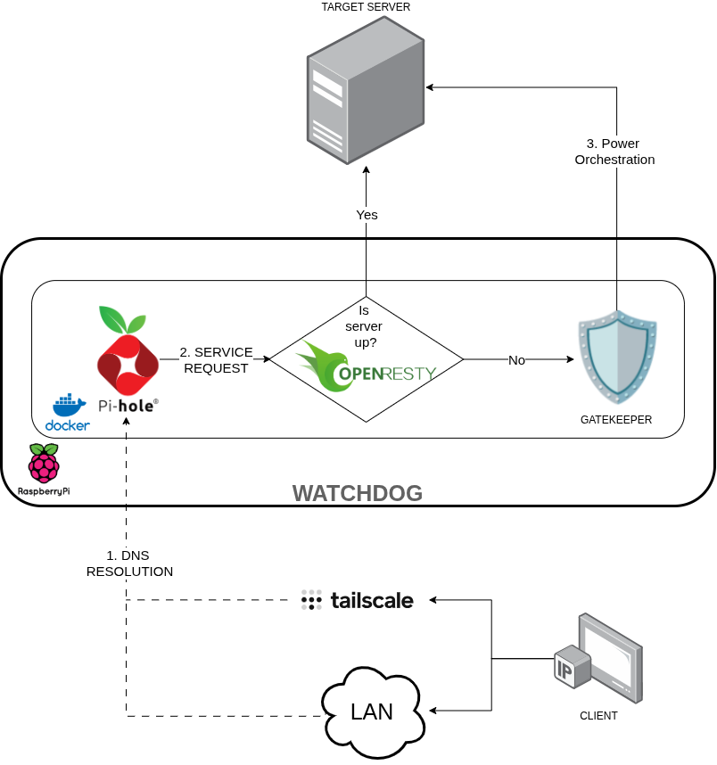

# Watchdog: Secure Tailscale Gateway for Private Cloud Fleet

A lightweight, containerised gateway designed for private cloud environments. It deploys reliably on single-board computers, such as the Raspberry Pi 3B+, providing secure Tailscale networking, split DNS resolution via Pi-hole, dynamic multi-node reverse proxy routing with OpenResty, and central power orchestration capabilities for heterogenous node fleets.

## Features
- **Secure Tailscale networking**: Provides a unified service namespace with integrated networking, enabling zero configuration remote access while preventing direct exposure to the local area network.
- **Dynamic multi-node reverse proxy**: Probes target server reachability and dynamically routes client traffic based on service availability using OpenResty (Nginx + Lua).
- **DNS resolution**: Pi-hole resolves local service domains, serves Tailscale tailnet queries, and blocks advertisements across both networks.
- **Multi-target power control**: Supports Wake-on-LAN broadcasts and remote shutdown mechanisms tailored by target system type.
- **Containerised deployment**: Delivers services as Docker containers for streamlined operation.

## System Architecture Overview

The system operates in **headless mode**, with ingress restricted exclusively to authenticated Tailscale clients.



## Component Matrix

| Functionality               | Tool and Technology                              | Hosted On      |
|-----------------------------|--------------------------------------------------|----------------|
| Operating System            | Ubuntu Core                                      | Raspberry Pi   |
| Conditional Routing         | OpenResty (Nginx + Lua)                          | Raspberry Pi   |
| DNS Resolver                | Pi-hole                                          | Raspberry Pi   |
| Power Orchestration         | Wake-on-LAN, SSH, Proxmox API, Streamlit         | Raspberry Pi   |
| Secure Networking           | Tailscale                                        | Raspberry Pi   |

> _For more details refer to the [System Architecture Document](doc/architecture.md)_

## Supported Target Modes

Watchdog supports power orchestration across three distinct node types configured in `services.json`:

### 1. Linux Distribution Mode (`"type": "linux"`)
Designed for generic Linux servers.
- **Wake-on-LAN**: Transmits magic packets to wake offline nodes.
- **Remote Shutdown**: Uses SSH with key-based authentication and restricted command privileges to execute `/sbin/shutdown now`.
- **Onboarding Scripts:**
   - [openSUSE MicroOS](target/setup-opensuse-microos-host.sh)
   - [Ubuntu Server 24.04.2 LTS](target/setup-ubuntu-server-24.04.2-lts-host.sh)

### 2. Proxmox VE Mode (`"type": "proxmox"`)
Optimised for Proxmox Virtual Environment hypervisor nodes.
- **Wake-on-LAN**: Transmits magic packets to wake offline hypervisor nodes.
- **Remote Shutdown**: Issues HTTPS API calls authenticated via Proxmox API tokens requiring `Sys.PowerMgmt` privileges.
- **Onboarding Script:**
   - [Proxmox VE 8.3-1](target/setup-proxmox-proxmox-ve-8.3-1-host.sh)

### 3. Windows 11 Pro Mode (`"type": "windows"`)
Integrated for workstations and non-server Windows hosts.
- **Wake-on-LAN**: Transmits magic packets to wake offline machines.
- **Remote Shutdown**: Displays session status notice instructing users to execute manual shutdowns directly over native protocols (RDP, VNC).

## How It Works
- **DNS Resolution**: Pi-hole intercepts DNS queries for custom tailnet service domains and resolves them to Watchdog's Tailscale IP (`HOST_IP`).
- **Reverse Proxy Probe**: OpenResty executes Lua TCP probes against the target health port defined in `services.json`:
  - If **UP**: Directly forwards request traffic to the backend endpoint.
  - If **DOWN**: Redirects client browser to Gatekeeper attached with the target node context (`http://<HOST_IP>:8501/?node=<NODE_KEY>`).
- **Gatekeeper UI**: Context-aware Streamlit interface rendering node status, Wake-on-LAN triggers, and specific remote shutdown panels based on node type (`linux`, `proxmox`, `windows`).

## Getting Started

> **_Deployment requires a two-phase process. The HOST_IP (Tailscale IP of Watchdog) is assigned after Tailscale container authentication and is unavailable initially. Phase 1 acquires the IP; Phase 2 applies complete network routing._**

> _Docker and Docker Compose must be installed prior to deployment._

### Phase 1: Initial Deployment (Acquire Tailscale IP)

1. Clone the repository.

2. Create a `.env` file in the root directory:
    ```bash
    FTLCONF_dns_upstreams="1.1.1.1;8.8.8.8" # Upstream DNS servers used by Pi-hole
    FTLCONF_webserver_api_password="" # Password for Pi-hole web interface

    HOST_IP="placeholder" # Tailscale IP address of Watchdog host
    HOSTNAME="watchdog-gateway" # Hostname for Tailscale container
    HOST_PARENT_INTERFACE="" # Physical network interface (e.g. eth0)

    TS_AUTHKEY="" # Tailscale authentication key

    TZ="Asia/Kolkata" # System Timezone
    WATCHDOG_IP="" # Macvlan IP address for Watchdog container
    WATCHDOG_MAC="" # Macvlan MAC address for Watchdog container
    ```

3. Create initial placeholder configuration files for `99-custom-dns.conf` and `services.json`.

4. Launch the initial stack:
    ```bash
    sudo docker compose up -d
    ```

5. Approve the device in the [Tailscale Admin Console](https://login.tailscale.com/admin/machines) and record Watchdog's assigned Tailscale IP address.

### Phase 2: Full Configuration and Redeployment

1. Update the `HOST_IP` value in `.env` with the assigned Tailscale IP address.

2. Update `99-custom-dns.conf` with custom DNS entries mapping domain names to `HOST_IP`:
    ```conf
    address=/<SERVICE_DOMAIN_NAME>/<HOST_IP>
    ```

3. Configure `services.json` with hardware node definitions and domain routes:
    ```json
    {
      "nodes": {
        "server-1": {
          "ip": "100.121.251.124",
          "mac": "AA:BB:CC:DD:EE:01",
          "health_port": 9090,
          "type": "linux"
        },
        "server-2": {
          "ip": "100.121.251.125",
          "mac": "AA:BB:CC:DD:EE:02",
          "health_port": 3389,
          "type": "windows"
        }
      },
      "routes": {
        "cockpit.server-1": {
          "target": "100.121.251.124:9090",
          "node": "server-1"
        },
        "desktop.server-2": {
          "target": "100.121.251.125:3389",
          "node": "server-2"
        }
      }
    }
    ```

4. Rebuild and restart the container stack:
    ```bash
    sudo docker compose down && sudo docker compose up -d --build
    ```

5. In the Tailscale Admin Console, set Pi-hole's Tailscale IP as the custom nameserver with "Override local DNS" enabled.

## Setting Up Target Nodes

1. **Linux Distribution Mode**:
   - Transfer setup script (`setup-ubuntu-server-24.04.2-lts-host.sh` or `setup-opensuse-microos-host.sh`) to target server.
   - Run script as root and paste public SSH key when prompted.
   - Configures `gatekeeper` system user, command-restricted `authorized_keys`, and passwordless `/sbin/shutdown` sudoers policy.

2. **Proxmox VE Mode**:
   - Transfer setup script (`setup-proxmox-proxmox-ve-8.3-1-host.sh`) to Proxmox VE host.
   - Run script as root.
   - Provisions `gatekeeper@pve` user, custom `gatekeeper` role with `Sys.PowerMgmt` privileges, and generates API token credentials.

3. **Windows 11 Pro Mode**:
   - Ensure Wake-on-LAN (Magic Packet) is enabled on the network interface and BIOS/UEFI settings.

## Pi-hole Split DNS Configuration

1. Configure LAN devices or local router DHCP settings to use Pi-hole's local IP address for DNS resolution.

2. Tailscale Admin Console Configuration:
   - Navigate to `DNS > Nameservers > Add nameserver > Custom`.
   - **Nameserver**: Enter Pi-hole's Tailscale IP address.
   - **Restrict to domain**: Enable option and specify service base domain.
   - **Use with exit node**: Disable option.
   - Save configuration.